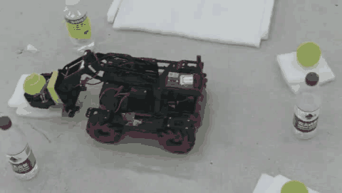
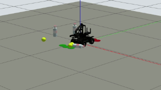

<div align="center">

**English** · [简体中文](./README.zh-CN.md)

# RoboMaster EP Six-Object Sorting

A RoboMaster EP finds tennis balls and water bottles with YOLO, grasps them on an IR trigger, and sorts them by class.

[Results](#results) · [Demo](#demo) · [How it works](#how-it-works) · [Quick start](#quick-start) · [Environment](#environment)

[![Ubuntu 20.04][ubuntu-shield]][ubuntu-link]
[![ROS 2 Foxy][ros-shield]][ros-link]
[![Python 3.8][python-shield]][python-link]
[![Jetson Orin NX][jetson-shield]][jetson-link]



<sub>Real robot, one full run: 3 tennis balls and 3 bottles sorted into two zones (20× speed)</sub>

</div>

## Results

| Part | What | Key result | Guide / evidence |
| :-- | :-- | :-- | :-- |
| ✅&nbsp;Six-object sorting | Real robot, full task | [6/6 placed (3 balls, 3 bottles) in 4 min 10 s](records/object_sorting/20260919/object-sort-19700101T011245258885Z/run.json)¹ | [Flow and angles](docs/object_sorting.md) · [Video](photos/result.mp4) |
| ✅&nbsp;Single-object demo | Real robot, one ball or bottle | Full cycle for [ball](records/yolo_alignment/20260918/yolo-align-19700101T035651387074Z/run.json) and [bottle](records/yolo_alignment/20260918/yolo-align-19700101T041506006690Z/run.json); return-to-start error 6.33 mm / 5.66 mm | [Demo guide](docs/yolo_align_pick_place_demo.md) · [Test notes](docs/yolo_alignment_hardware_tests.md) |
| 🚧&nbsp;ROS 2 wrapper | Nodes, action, state machine, launch file | No full hardware run archived yet | [ROS 2 guide](ros2_ws/README.md) |
| 🚧&nbsp;Gazebo simulation | Same detector in Gazebo | [1/6 placed, run not completed](records/simulation/gazebo-sort-19700101T052904Z/summary.json) | [Simulation guide](ros2_ws/src/ep_sorting_sim/README.md) |

<sub>✅ done · 🚧 in progress</sub>

<sub>¹ "Placed" counts `sorting_item_placed` events: the arm finished a placement move. The log does not record where each object came to rest. The Jetson clock was not synchronized, so `1970` in run folder names is not the run date.</sub>

## Demo

<table>
  <tr><th>Test layout</th><th>IR sensor on the gripper</th></tr>
  <tr>
    <td></td>
    <td></td>
  </tr>
  <tr>
    <td align="center"><sub>Six objects around the start pose, one zone per class</sub></td>
    <td align="center"><sub>Grasp when the raw IR reading is ≤ 24 mm three times in a row</sub></td>
  </tr>
  <tr><th>Onboard detection</th><th>Gazebo simulation</th></tr>
  <tr>
    <td></td>
    <td></td>
  </tr>
  <tr>
    <td align="center"><sub><code>yolo26m.pt</code> during the 6/6 run: bottle 0.95 on the grasp axis</sub></td>
    <td align="center"><sub>Gazebo Classic 11 scene; the archived run placed 1 of 6</sub></td>
  </tr>
</table>

Full real-robot run (sped up):

https://github.com/user-attachments/assets/731c6d1a-fc6a-4c20-8b2b-e82314770e40

Full-length original (3:25): [photos/result.mp4](photos/result.mp4) · Simulation recording: [simulation-final.mp4](records/simulation/simulation-final.mp4)

## How it works

- **Start pose**: arm extended, gripper open, so the gripper camera looks straight ahead. The start position and heading stay the reference for the whole run.
- **Search**: six headings (0°, ±36°, ±144°, 180°). After each placement the robot turns to the nearest heading it has not searched yet, with the arm retracted while turning.
- **Align and approach**: the chassis turns in 5° steps until the YOLO box is centered on the grasp axis, then moves forward about 1 cm at a time. The camera has no depth, so the IR sensor decides when the object is within reach.
- **Carry and place**: retract, back up along the recorded path to the start, then turn to the class zone: balls to the right, bottles to the left, three slots each.
- **Errors**: stop and turn the LEDs red; no automatic reset.

The course task asked for a tabletop grid. This project uses six search headings around the robot instead ([original task, Chinese](docs/task_requirements.md)).

## Quick start

No robot needed. Run the unit tests (checked with Python 3.9 on macOS):

```bash
python3 -m pip install numpy opencv-python-headless pyyaml
python3 -m unittest discover -s tests
```

On the robot, from [docs/object_sorting.md](docs/object_sorting.md) (not re-run for this README):

```bash
bash scripts/run_sorting_ubuntu.sh
bash scripts/run_sorting_ubuntu.sh --observe --observe-frames 3
bash scripts/run_sorting_ubuntu.sh --execute
```

The first command only previews the config and does not connect to the robot. For the ROS 2 launch file see [ros2_ws/README.md](ros2_ws/README.md).

## Environment

| Machine | Role | Software |
| :-- | :-- | :-- |
| RoboMaster EP | Mecanum chassis, two-servo arm, gripper, camera, IR sensor | `robomaster` SDK |
| Jetson Orin NX | Detection and control | Ubuntu 20.04, Python 3.8, ROS 2 Foxy, Gazebo Classic 11, Ultralytics |
| Any PC | Unit tests | Python 3, numpy, OpenCV, PyYAML |

<sub>Jetson versions come from the repository's guides.</sub>

> [!NOTE]
> Do not source ROS 1 Noetic and ROS 2 Foxy in the same shell. See [ros2_ws/README.md](ros2_ws/README.md).

## Repository layout

```text
.
├── scripts/       robot programs: IR demo, YOLO alignment demo, six-object sorting
├── config/        servo, IR, heading and placement parameters; state machine YAML
├── ros2_ws/       ROS 2 packages: ep_sorting, interfaces, Gazebo simulation, EP model
├── models/        yolo26m.pt (stock Ultralytics weights)
├── records/       run logs from the robot and the simulation
├── docs/          guides and hardware test notes (Chinese)
├── tests/         unit tests
├── photos/        real-robot video and setup photos
├── presentation/  slides
└── assets/        README media
```

## Acknowledgements

- EP model meshes from [jeguzzi/robomaster_ros](https://github.com/jeguzzi/robomaster_ros) (MIT, license kept in `ros2_ws/src/robomaster_description/`).
- Detector weights: [Ultralytics `yolo26m.pt` v8.4.0](https://github.com/ultralytics/assets/releases/tag/v8.4.0), COCO classes 32 (sports ball) and 39 (bottle).

<sub>Released under the [MIT License](LICENSE).</sub>

<!-- badge definitions: copy this block verbatim into every translation -->
[ubuntu-shield]: https://img.shields.io/badge/Ubuntu-20.04-E95420?logo=ubuntu&logoColor=white
[ubuntu-link]: https://releases.ubuntu.com/focal/
[ros-shield]: https://img.shields.io/badge/ROS%202-Foxy-22314E?logo=ros&logoColor=white
[ros-link]: https://docs.ros.org/en/foxy/
[python-shield]: https://img.shields.io/badge/Python-3.8-3776AB?logo=python&logoColor=white
[python-link]: https://www.python.org/downloads/release/python-380/
[jetson-shield]: https://img.shields.io/badge/Jetson-Orin%20NX-76B900?logo=nvidia&logoColor=white
[jetson-link]: https://developer.nvidia.com/embedded/jetson-orin
